## Assessing Nonlinearities & Model Specification Using Predictions

:::: {.columns}
::: {.column width="60%"}
- Before you fit a model, it is important to examine the functional form of the relationship between your predictor and your outcome (don't assume linearity!)
- Above, we covered some bivariate methods (consider only *x* and *y*)
  - However, most of our models include multiple predictors / control variables
- Ordinal predictors can be specified as continuous or nominal, with tradeoffs
:::
::: {.column width="40%"}
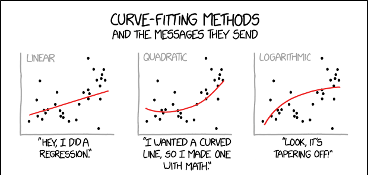{fig-alt="xkcd comic Curve-Fitting Methods and the Messages They Send: linear (Hey I did a regression), quadratic (I wanted a curved line so I made one with math), and logarithmic (Look, it's tapering off!)."}
:::
::::

## Treating continuous predictors as nominal

- An elegantly simple but remarkably flexible way to examine the functional form of a continuous or ordinal IV is to treat it as a nominal variable in your regression model
  - E.g., For a count variable of \# of *chronic diseases* (0 to 8) omit 0 as reference category; add coefficients for 1, 2, 3, 4...8 diseases
  - For IVs with lots of values, you can "coarsen" or "bin" them first
    - E.g., Create age categories of 20 -- 30, 31 -- 40, 41 -- 50, etc.
      - Use [cut( )](https://www.rdocumentation.org/packages/base/versions/3.6.2/topics/cut) function in R
- Can use this technique for almost any regression model and almost any outcome
  - Can also incorporate control variables
  - Can incorporate fixed and/or random effects
  - Etc.
- For this technique, you want to go straight to graphs rather than worrying about the coefficient estimates

::: {.panel-tabset group="language"}
## Stata

```{.stata-run}
. use "https://tdmize.github.io/data/data/cda_ah4.dta", clear
(cda_ah4.dta | Add Health Wave 4 - | )

. 
. codebook role masterySS age income race exercisSS, c

Variable    Obs Unique       Mean        Min       Max  Label
--------------------------------------------------------------------------------
role       5013     11   5.778177          0        10  Role Count - Total
masterySS  5106    566  -.0013007  -4.106874  1.343777  Mastery Scale
age        5114     10   28.42257         24        33  Age
income     4989    354   32.59629          0       150  Personal Income
race       5109      4   1.350949          1         4  Race of R
exercisSS  5109     37   6.105696          0        40  Exercise Activity Sca...
--------------------------------------------------------------------------------

. 
. // 10.g - Number of social roles entered as nominal
. qui reg masterySS i.role c.age c.income i.race c.exercisSS

. 
. *Save predictions for later use
. margins, at(role=(0(1)10)) saving(prs_nom, replace)

Predictive margins                                       Number of obs = 4,890
Model VCE: OLS

Expression: Linear prediction, predict()
1._at:  role =  0
2._at:  role =  1
3._at:  role =  2
4._at:  role =  3
5._at:  role =  4
6._at:  role =  5
7._at:  role =  6
8._at:  role =  7
9._at:  role =  8
10._at: role =  9
11._at: role = 10

------------------------------------------------------------------------------
             |            Delta-method
             |     Margin   std. err.      t    P>|t|     [95% conf. interval]
-------------+----------------------------------------------------------------
         _at |
          1  |     -1.107      0.406   -2.729   0.006       -1.902      -0.312
          2  |     -0.391      0.141   -2.775   0.006       -0.667      -0.115
          3  |     -0.477      0.077   -6.200   0.000       -0.628      -0.326
          4  |     -0.238      0.048   -4.949   0.000       -0.333      -0.144
          5  |     -0.067      0.030   -2.234   0.026       -0.125      -0.008
          6  |     -0.029      0.022   -1.361   0.174       -0.071       0.013
          7  |      0.042      0.019    2.181   0.029        0.004       0.079
          8  |      0.095      0.022    4.273   0.000        0.051       0.138
          9  |      0.123      0.032    3.797   0.000        0.060       0.187
         10  |      0.050      0.069    0.732   0.464       -0.085       0.185
         11  |      0.309      0.222    1.391   0.164       -0.127       0.745
------------------------------------------------------------------------------

. 
. marginsplot, ///
>     title("[10.g] Predicted mastery levels based on # of social roles held") /
> //
>     ytitle("Mastery") xtitle("Number of Social Roles")

Variables that uniquely identify margins: role

```

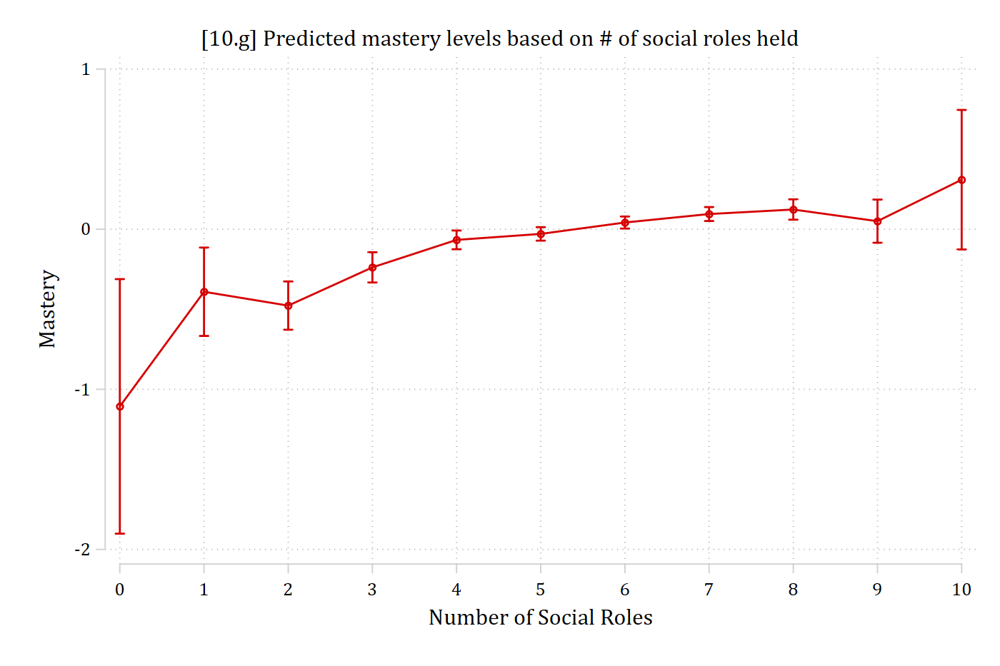{width=80% fig-alt="[10.g] Predicted mastery for 0 to 10 social roles, with roles entered as nominal and 95% confidence intervals: mastery is lowest with 0 roles (about -1.1, with a very wide interval), rises quickly to about -0.4 to -0.5 with 1 or 2 roles, and then rises gradually to about 0.1 with 7 or 8 roles."}

## R

```{r}
#| fig-alt: "[10.g] Predicted mastery for 0 to 10 social roles, with roles entered as nominal and 95% confidence intervals: mastery is lowest with 0 roles, rises quickly with 1 to 3 roles, and then rises gradually."
library(foreign)            # load Stata datasets
library(ggplot2)            # main graphics package
library(dplyr)              # data manipulation tools
library(marginaleffects)    # predictions and marginal effects
library(cleanplots)         # Mize's graphics scheme

## Use cleanplots colors, markers, lines, and theme for all graphs ##
cleanplots_defaults()
theme_update(plot.title.position = "plot")   # titles start at left edge of graph

# Add Health Wave 4 Data (social roles ex)
cda_ah4 <- droplevels(read.dta("https://tdmize.github.io/data/data/cda_ah4.dta"))

# 10.g - Number of social roles entered as nominal (factor)
reg_roles_nom <- lm(masterySS ~ factor(role) + age + income + race + exercisSS,
                    data = cda_ah4)

plot_predictions(reg_roles_nom, condition = "role") +
  labs(x = "Number of Social Roles", y = "Mastery",
       title = "[10.g] Predicted mastery levels based on # of social roles held")
```

:::

### Comparing nominal and continuous specifications

- The nominal approach is mostly meant as descriptive
  - It took 10 coefficient estimates for the predictions above
- Compare nominal specification to a nonlinear continuous specification
  - E.g., Polynomials like *roles* and *roles^2^*
- Overlay predictions from the two specifications
  - Stata: **combomarginsplot**; R: **ggplot** (see code files)

::: {.panel-tabset group="language"}
## Stata

```{.stata-run}
. // 10.h - Compare to roles and roles^2 (quadratic) specification
. qui reg masterySS c.role##c.role c.age c.income i.race c.exercisSS

. 
. margins, at(role=(0(1)10)) saving(prs_sq, replace)

Predictive margins                                       Number of obs = 4,890
Model VCE: OLS

Expression: Linear prediction, predict()
1._at:  role =  0
2._at:  role =  1
3._at:  role =  2
4._at:  role =  3
5._at:  role =  4
6._at:  role =  5
7._at:  role =  6
8._at:  role =  7
9._at:  role =  8
10._at: role =  9
11._at: role = 10

------------------------------------------------------------------------------
             |            Delta-method
             |     Margin   std. err.      t    P>|t|     [95% conf. interval]
-------------+----------------------------------------------------------------
         _at |
          1  |     -0.735      0.097   -7.604   0.000       -0.925      -0.546
          2  |     -0.541      0.066   -8.185   0.000       -0.671      -0.412
          3  |     -0.373      0.042   -8.848   0.000       -0.455      -0.290
          4  |     -0.229      0.025   -9.136   0.000       -0.278      -0.180
          5  |     -0.111      0.016   -7.026   0.000       -0.142      -0.080
          6  |     -0.018      0.013   -1.386   0.166       -0.043       0.007
          7  |      0.050      0.012    4.126   0.000        0.026       0.073
          8  |      0.092      0.013    7.117   0.000        0.067       0.118
          9  |      0.110      0.021    5.177   0.000        0.068       0.151
         10  |      0.102      0.038    2.695   0.007        0.028       0.176
         11  |      0.069      0.061    1.118   0.264       -0.052       0.189
------------------------------------------------------------------------------

. 
. combomarginsplot prs_nom prs_sq, ///
>     labels("Categorical Model" "Roles^2 Model") ///
>     title("[10.h] Comparison of Predictions for Various Functional Forms of Ro
> les") ///
>     ytitle("Mastery") xtitle("Number of Social Roles") ///
>     legend(pos(6) row(1))

  Variables that uniquely identify margins: role _filenumber

```

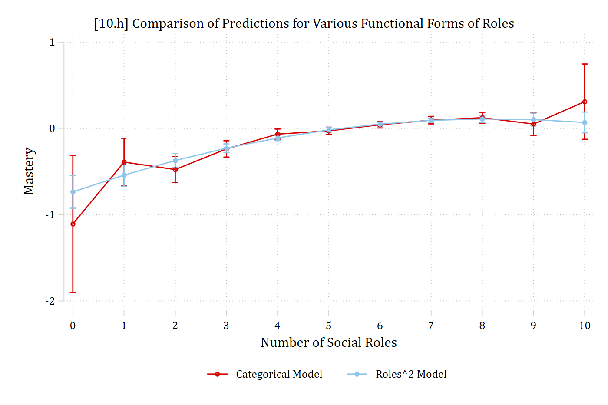{width=80% fig-alt="[10.h] Predicted mastery by number of social roles from the nominal (categorical) model and from the roles plus roles-squared model, overlaid: the two sets of predictions are close from 1 to 9 roles; the quadratic model predicts less extreme mastery at 0 and 10 roles, where the categorical predictions have wide intervals."}

## R

```{r}
#| fig-alt: "[10.h] Predicted mastery by number of social roles from the nominal (categorical) model and from the roles plus roles-squared model, overlaid: the two sets of predictions are close from 1 to 9 roles; the quadratic model predicts less extreme mastery at 0 and 10 roles."
# 10.h - Compare to roles and roles^2 (quadratic) specification
reg_roles_sq <- lm(masterySS ~ poly(role, 2, raw = TRUE) + age + income + race + exercisSS,
                   data = cda_ah4)

pred_roles_nom <- plot_predictions(reg_roles_nom, condition = "role", draw = FALSE)
pred_roles_nom$role <- as.numeric(as.character(pred_roles_nom$role))

plot_predictions(reg_roles_sq, condition = "role") +
  aes(color = "Roles^2 Model", fill = "Roles^2 Model") +
  geom_pointrange(data = pred_roles_nom,
                  aes(x = role, y = estimate, ymin = conf.low, ymax = conf.high,
                      color = "Categorical Model"), inherit.aes = FALSE) +
  labs(x = "Number of Social Roles", y = "Mastery", color = NULL, fill = NULL,
       title = "[10.h] Comparison of Predictions for Various Functional Forms of Roles") +
  scale_x_continuous(breaks = 0:10) +
  scale_color_manual(values = unname(cleanplots_colors("red", "ltblue"))) +
  scale_fill_manual(values = unname(cleanplots_colors("ltblue", bars = TRUE))) +
  guides(fill = "none")
```

:::

## Specifying ordinal predictors

- Independent variables can be entered into a regression model one of two ways:
  - Continuous or nominal (n.b., binary is nominal but with only 2 categories)
- For an ordinal predictor, you must choose (ordinal is not an option)
  - Continuous is simpler
    - E.g., For a 5-category ordinal IV only need to estimate 1 coefficient
  - Nominal is more complicated but always more accurate\*
    - If entering as nominal, need 4 coefficients (representing 4 categories and one omitted reference category)
    - 4 coefficients will always provide a somewhat better fit\* than 1
- Which should you choose? Try both:
  - If inferences are very similar, choose the simpler specification (continuous)
  - If inferences diverge, choose the more complicated but more accurate specification (nominal)

\*You can get a significance test of this. But *R*^2^ will always be the same or higher in nominal specification (even if not significantly different). An information criterion like AIC or BIC is more helpful

::: {.panel-tabset group="language"}
## Stata

```{.stata-run}
. use "https://tdmize.github.io/data/data/cda_anes.dta", clear
(American National Election Study 2020 - Pre-election | CDA | 2021-09-26)

. 
. drop if missing(vote_trump, age, hhincome, woman, lgb, race4, ///
>     educ, relimport, wrongtrack)
(1,423 observations deleted)

. tab relimport

 Importance of religion |
                   to R |      Freq.     Percent        Cum.
------------------------+-----------------------------------
 1. Extremely important |      1,835       26.76       26.76
      2. Very important |      1,310       19.10       45.87
3. Moderately important |      1,326       19.34       65.20
  4. A little important |        904       13.18       78.39
5. Not important at all |      1,482       21.61      100.00
------------------------+-----------------------------------
                  Total |      6,857      100.00

. 
. // 10.i - Importance of religion entered as nominal
. qui logit vote_trump i.educ i.relimport age hhincome i.woman ///
>     i.lgb i.race4 i.wrongtrack

. est store nom_rel

. 
. margins, at(relimport=(1(1)5)) saving(pr_rel_nom, replace)

Predictive margins                                       Number of obs = 6,857
Model VCE: OIM

Expression: Pr(vote_trump), predict()
1._at: relimport = 1
2._at: relimport = 2
3._at: relimport = 3
4._at: relimport = 4
5._at: relimport = 5

------------------------------------------------------------------------------
             |            Delta-method
             |     Margin   std. err.      z    P>|z|     [95% conf. interval]
-------------+----------------------------------------------------------------
         _at |
          1  |      0.556      0.011   52.435   0.000        0.536       0.577
          2  |      0.460      0.011   40.246   0.000        0.437       0.482
          3  |      0.408      0.010   39.333   0.000        0.388       0.429
          4  |      0.373      0.012   31.464   0.000        0.350       0.396
          5  |      0.282      0.009   30.911   0.000        0.264       0.300
------------------------------------------------------------------------------

. marginsplot, ///
>     xlab(1 "Ext. Important" 2 "Very Important" 3 "Moderately Important" ///
>         4 "A Little Important" 5 "Not Important") graphregion(margin(r+5)) ///
>     ytitle("Pr(support Trump)") xtitle("Importance of religion") ///
>     title("[10.i] Pr(support Trump) by importance of religion -- Nominal speci
> fication")

Variables that uniquely identify margins: relimport

```

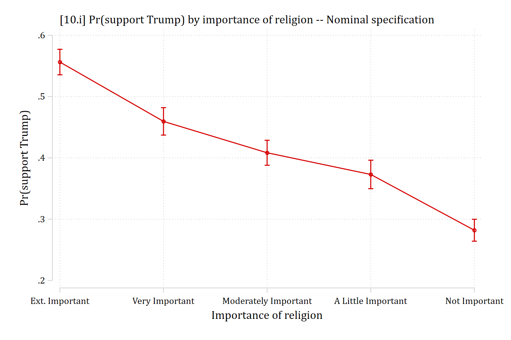{width=80% fig-alt="[10.i] Predicted probability of supporting Trump by the importance of religion, with religion entered as nominal and 95% confidence intervals: the probability falls steadily from about .56 for extremely important to about .28 for not important."}

## R

```{r}
#| fig-alt: "[10.i] Predicted probability of supporting Trump by the importance of religion, with religion entered as nominal and 95% confidence intervals: the probability falls steadily as religion becomes less important."
# American National Election Study 2020 Data
anes <- droplevels(read.dta("https://tdmize.github.io/data/data/cda_anes.dta"))

anes_mod <- anes %>%
  filter(!is.na(vote_trump), !is.na(age), !is.na(hhincome), !is.na(woman), !is.na(lgb),
         !is.na(race4), !is.na(educ), !is.na(relimport), !is.na(wrongtrack)) %>%
  droplevels()

# 10.i - Importance of religion entered as nominal (factor)
logit_rel_nom <- glm(vote_trump ~ educ + relimport + age + hhincome + woman +
                       lgb + race4 + wrongtrack,
                     family = binomial, data = anes_mod)

plot_predictions(logit_rel_nom, condition = "relimport") +
  labs(x = "Importance of religion", y = "Pr(support Trump)",
       title = "[10.i] Pr(support Trump) by importance of religion -- Nominal specification") +
  scale_x_discrete(labels = c("E. Important", "V. Important", "Mod. Important",
                              "Little Important", "Not Important"))
```

:::

::: {.panel-tabset group="language"}
## Stata

```{.stata-run}
. // 10.j - Compare to importance of religion entered as continuous
. qui logit vote_trump c.relimport i.educ age hhincome i.woman ///
>     i.lgb i.race4 i.wrongtrack

. est store con_rel

. 
. lrtest nom_rel con_rel

Likelihood-ratio test
Assumption: con_rel nested within nom_rel

 LR chi2(3) =   9.29
Prob > chi2 = 0.0257

. 
. margins, at(relimport=(1(1)5)) saving(pr_rel_con, replace)

Predictive margins                                       Number of obs = 6,857
Model VCE: OIM

Expression: Pr(vote_trump), predict()
1._at: relimport = 1
2._at: relimport = 2
3._at: relimport = 3
4._at: relimport = 4
5._at: relimport = 5

------------------------------------------------------------------------------
             |            Delta-method
             |     Margin   std. err.      z    P>|z|     [95% conf. interval]
-------------+----------------------------------------------------------------
         _at |
          1  |      0.551      0.009   62.227   0.000        0.534       0.568
          2  |      0.477      0.006   79.879   0.000        0.465       0.488
          3  |      0.408      0.005   84.411   0.000        0.398       0.417
          4  |      0.346      0.006   60.516   0.000        0.335       0.357
          5  |      0.292      0.007   40.184   0.000        0.278       0.306
------------------------------------------------------------------------------

. 
. combomarginsplot pr_rel_nom pr_rel_con, ///
>     labels("Nominal spec." "Continuous spec.") ytitle("Pr(support Trump)") ///
>     xlab(1 "E. Important" 2 "V. Important" 3 "Mod. Important" ///
>         4 "Little Important" 5 "Not Important") graphregion(margin(r+5)) ///
>     xtitle("Importance of religion") ///
>     title("[10.j] Pr(support Trump) by importance of religion - comparing IV s
> pecifications")

  Variables that uniquely identify margins: relimport _filenumber

```

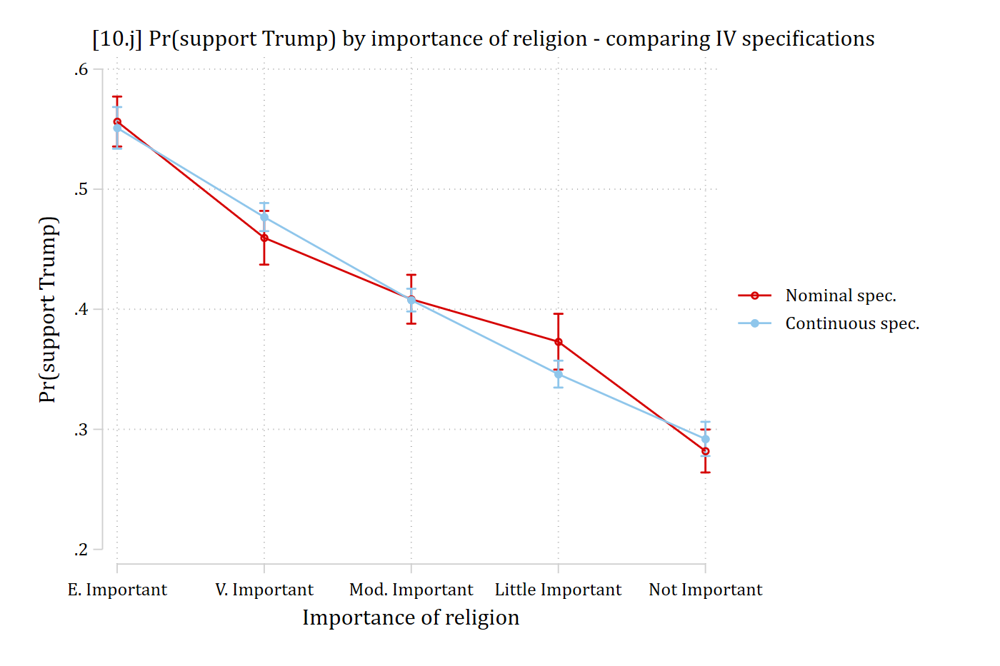{width=80% fig-alt="[10.j] Predicted probabilities of supporting Trump from the nominal and the continuous specifications of the importance of religion, overlaid: the two lines are very close, differing most at a little important (about .37 vs .35)."}

## R

```{r}
#| fig-alt: "[10.j] Predicted probabilities of supporting Trump from the continuous specification (line) and the nominal specification (red dots), overlaid: the two are very close."
# 10.j - Compare to importance of religion entered as continuous (numeric)
anes_mod$relimportC <- as.numeric(anes_mod$relimport)

logit_rel_con <- glm(vote_trump ~ educ + relimportC + age + hhincome + woman +
                       lgb + race4 + wrongtrack,
                     family = binomial, data = anes_mod)

pred_rel_nom <- plot_predictions(logit_rel_nom, condition = "relimport", draw = FALSE)

plot_predictions(logit_rel_con, condition = "relimportC") +
  geom_pointrange(data = pred_rel_nom,
                  aes(x = as.numeric(relimport), y = estimate,
                      ymin = conf.low, ymax = conf.high),
                  color = cleanplots_colors("red"), inherit.aes = FALSE) +
  scale_x_continuous(breaks = 1:5, expand = expansion(mult = .08),
                     labels = c("E. Important", "V. Important", "Mod. Important",
                                "Little Important", "Not Important")) +
  labs(x = "Importance of religion", y = "Pr(support Trump)",
       title = "[10.j] Pr(support Trump) by importance of religion - comparing IV specifications",
       subtitle = "Continuous specification (line) vs nominal specification (red dots)")
```

:::

### Choosing confidence intervals or standard errors

- In my opinion, plots designed to show group differences (e.g., bar charts) are sometimes more effective with standard error bars than confidence intervals
  - Standard errors are intuitive
    - Regression tables are normative and most often include standard errors as measures of uncertainty
  - Standard errors = 68% confidence intervals
    - 68% confidence intervals = ± 1 SE
    - 95% confidence intervals = ± 1.96 SEs
- Confidence intervals are normative for line charts and coefficients plots
- Unless the measures of uncertainty (CI or SE) greatly hinder the interpretability of the plot, it is always best to include these on plots of sample data (i.e., data that does not include the entire population)
- Be clear in your graph and/or text whether CIs or SEs are being plotted
  - Audiences will assume they are 95% CIs unless you clearly state otherwise

### Use logical colors

- The colors you choose should not fight against logic or the audience's inclinations
  - E.g., When you think of Democrats: what color do you think of? For Republicans? For the Green Party?
    - But depends on your context and audience!

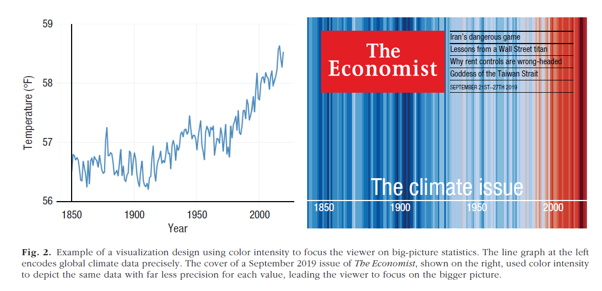{width=80% fig-alt="Figure from Franconeri et al. 2021: a line chart of global temperature over time next to The Economist's climate-stripes cover, where blue marks colder years and red hotter years."}

\*From [Franconeri 2021](https://doi.org/10.1177/09637214211009512). The colors correspond to the values of the temperature; the blue (for colder temps) and red (for hotter temps) are logical choices

## Graphics themes in R and color palettes

- Graphics themes (ggplot2's term) are sets of defaults for graphics
  - These can dramatically change the "look and feel" of a graph
  - See an [overview of what themes are and different options here](https://ggplot2.tidyverse.org/reference/ggtheme.html)
- Base R's default graphics theme leaves much to be desired
  - ggplot2's default theme (theme_gray) is much better, but still imperfect
  - The good news is there are good additional options built into ggplot2
- You can change a theme on a single graph by specifying it as an element on a ggplot2 graph. E.g.,

  ```r
  fig1 + theme_gray( )
  ```

### The cleanplots R package

- [cleanplots](https://tdmize.github.io/cleanplots/articles/cleanplots.html) is now also available as an R package to automate the best practices I've covered in these slides and use cleanplots colors
  - First, load or install the [remotes](https://remotes.r-lib.org/) package

    ```r
    install_github("tdmize/cleanplots")
    ```

- **scale_color_cleanplots()** --- Applies the cleanplots colors to a plot's color aesthetic; the theme and everything else are left unchanged
- **scale_fill_cleanplots(palette = "bars")** --- Applies the softer cleanplots colors to a plot's fill aesthetic, designed for ink-heavy elements like bars, boxplots, and areas
- **scale_shape_cleanplots()** --- Applies the cleanplots marker symbols: hollow shapes for the dark colors, solid shapes for the light colors, so groups are distinguishable even without color.
- **scale_linetype_cleanplots()** --- Applies the cleanplots line patterns (solid, solid, dashed, dashed, shortdash, shortdash, longdash, longdash), keeping line graphs readable in black & white and for colorblind readers.
- **theme_cleanplots()** --- Applies the cleanplots look to a single plot: white background, dotted gridlines, gray axis lines, frameless legend at the right, and outlined facet strips.
- **cleanplots_defaults()** --- One call applies the full cleanplots setup for the session: theme, automatic colors (main palette for color, soft bar palette for fill), larger markers, thicker lines, and customized fit lines.
- **cleanplots_save()** --- Saves a figure at a fixed, publication-ready size (7 × 5 inches, 300 dpi) so plots look the same regardless of your plot window. Format follows the file extension (.png, .pdf, .tiff, ...).

### Stata graphics and the cleanplots graphics schemes

**cleanplots** implements a host of features that draw on best data visualization practices (some of which are borrowed from the excellent black and white graphics scheme **plainplots** from [Bischof (2017)](https://www.dropbox.com/s/m5viis9oybgkept/FigureScheme.pdf?dl=0); these are also repeated in the excellent [**white_tableau**](https://github.com/asjadnaqvi/Stata-schemes) by Naqvi). This allows you to make publication quality Stata graphics with very little effort. With **cleanplots**, many of the defaults you would change before via code are already changed for you

For example:

- Default colors are easier to distinguish from each other and are more aesthetically pleasing
  - Default colors allow graphs to be printed in color or black and white
- Marker shapes and line features (e.g. solid, dashed, etc.) better distinguish lines and ensure lines will be distinguishable if printing in black and white
- All axis markers are horizontal -- thus easier to read
- A non-invasive light grid is on all plots
  - Both vertical and horizontal gridlines
- The background of the plot is white
- Legends are placed to right of the graph
- And many more!

### Presenting multiple model results

- Coefficient plots are very effective when the goal is to compare effects across models and/or groups
- E.g., If multiple models are fit for different groups, useful to plot coefficients from each model for easy comparison of effects
  - Confidence intervals are very important here

## Incorporating distributional information

- Distributional information about an IV can be incorporated into plots of predictions via overlaid histograms, kernel density plots, or rug plots
  - Especially useful when a distribution deviates notably from uniform or normal

:::: {.columns}
::: {.column width="70%"}
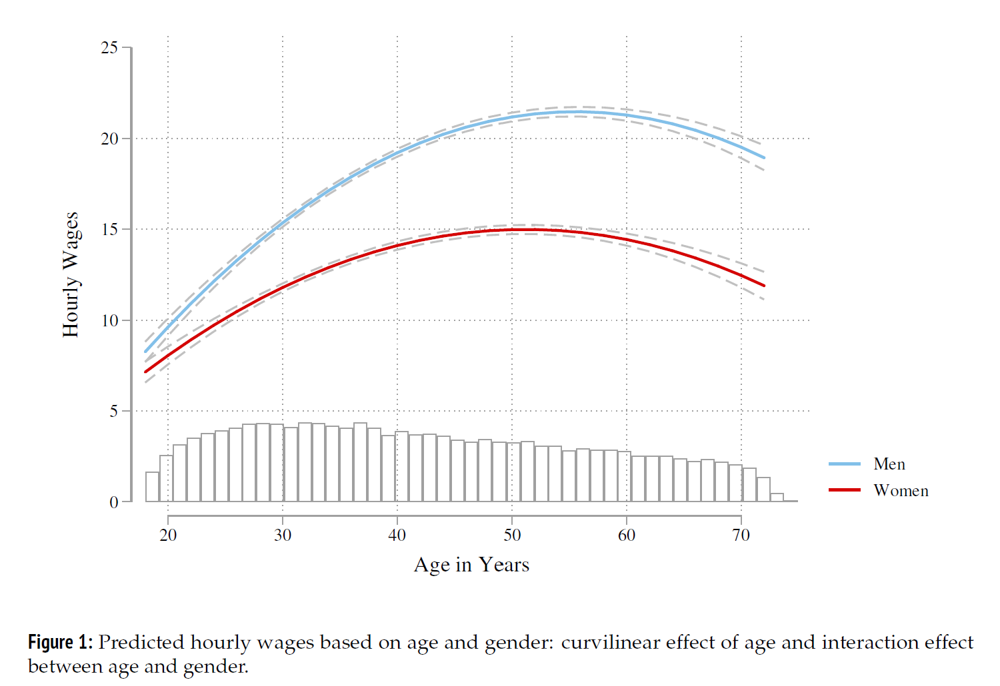{fig-alt="Published figure: predicted hourly wages by age for men and women with confidence intervals, with a histogram of age along the bottom."}
:::
::: {.column width="30%"}
::: {.callout-note icon="false" appearance="simple"}
Figure 1 from [Mize (2019)](https://www.sociologicalscience.com/articles-v6-4-81/)
:::
:::
::::

### Misleading example: area ≠ rate

{width=80% fig-alt="Infographic titled Under President Obama, more students are earning their high school diplomas than ever before: graduation rates from 75% to 82% drawn as stacks of books whose heights exaggerate the change."}

### Misleading examples: area ≠ rate or price

{width=40% fig-alt="Tufte example, The Shrinking Family Doctor: drawings of doctors whose sizes exaggerate the decline in the percentage of doctors devoted solely to family practice from 1964 to 1990."}
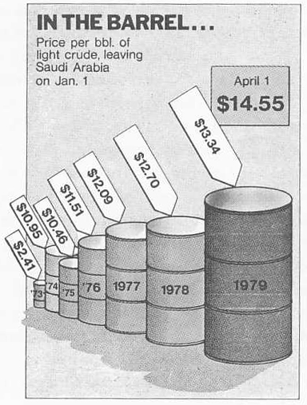{width=40% fig-alt="Tufte example, In the Barrel: oil barrels whose areas exaggerate the rise in the price of a barrel of Saudi Arabian light crude in the 1970s."}

\*Examples from [Tufte (1983)](https://www.edwardtufte.com/tufte/books_vdqi)

### 3-D Graphics: Just say no

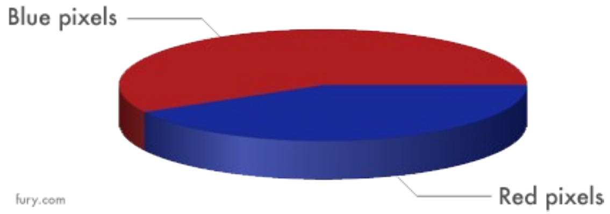{width=70% fig-alt="A 3-D pie chart of blue pixels and red pixels, labeled the opposite way from its colors."}

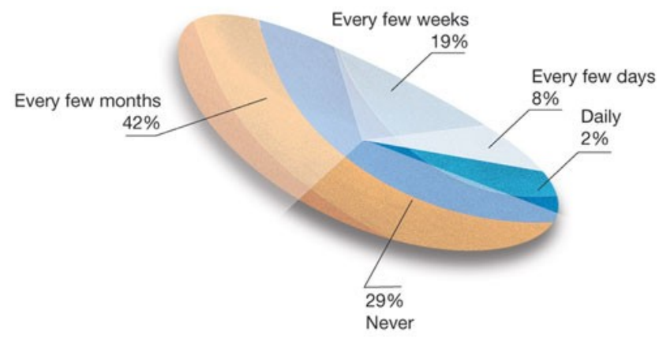{width=50% fig-alt="A tilted 3-D pie chart of how often people do something: every few months 42%, never 29%, every few weeks 19%, every few days 8%, and daily 2%."}

### General advice: 3D graphics

- 3D-graphics usually make it more difficult to read graphs rather than easier
  - It is very difficult to read the information encoded on the third (z) axis
  - Adding a third axis makes it more difficult to read the first two (x and y) axes!
- Without the ability to manipulate a 3D graphic---the choice of orientation greatly affects the perception of the plot (e.g. the length of lines)
- For all of these reasons, I recommend avoiding 3D-graphics
- **Exceptions**: 3-D graphics can sometimes be useful pedagogically (when you have ample time to explain them)
  - Can also work with "interactive" graphics where the user can spin the graph to look at it from multiple angles

### 3D graphs can be misleading

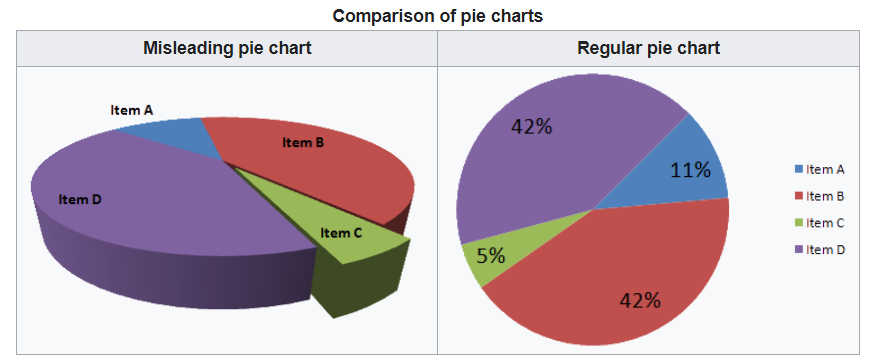{width=70% fig-alt="A misleading 3-D pie chart next to a regular pie chart of the same data: in the 3-D version the slices in the foreground look larger than those in the back."}

- Here, the 3-D nature of the graph is not only unnecessary---it also leads to a misleading graph where pie slices in the foreground look larger than those in the back

\*Image from [Wikipedia's "misleading graphs"](https://en.wikipedia.org/wiki/Misleading_graph) collection
