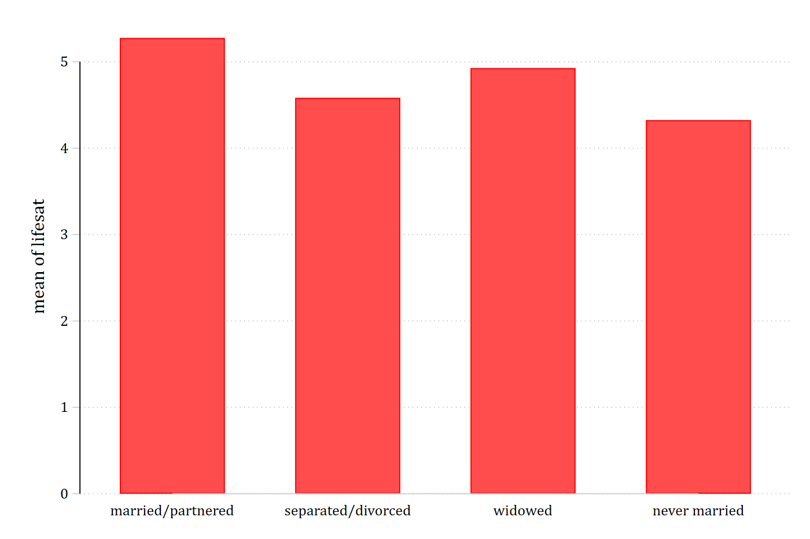
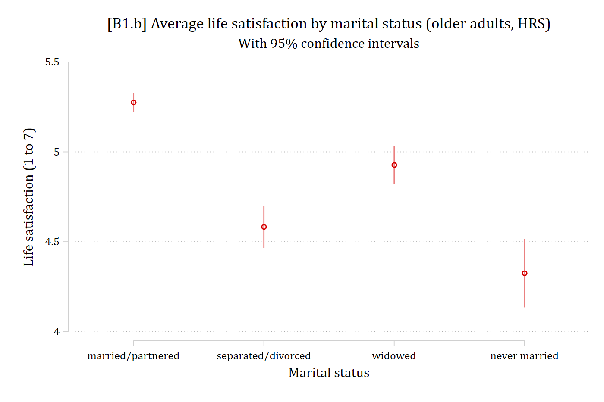

- Run the code below in R or Stata: it loads the data and makes a quick graph
- Discuss with your group:
  - What does the graph show? What do you learn?
  - What would you need to change to make the graph better (more effective and/or nicer to look at), beyond the defaults?

::: {.panel-tabset group="language"}
## Stata

```{.stata-run}
. use "https://tdmize.github.io/data/data/hrs_si.dta", clear
(Health and Retirement Study 1992-2022 - Cleaned for MCAP SI)

. 
. graph bar (mean) lifesat if year == 2022, over(marstat)

```

{width=80% fig-alt="Default bar chart of mean life satisfaction by marital status (married/partnered, separated/divorced, widowed, never married), with the y-axis labeled mean of lifesat and running from 0: the bars look similar in height, all between about 4.3 and 5.3."}

## R

```{r}
#| fig-alt: "Default bar chart of mean life satisfaction by marital status (married/partnered, separated/divorced, widowed, never married), with the y-axis labeled lifesat and running from 0: the bars look similar in height, all between about 4.3 and 5.3."
library(foreign); library(ggplot2); library(dplyr)

hrs <- read.dta("https://tdmize.github.io/data/data/hrs_si.dta")

ggplot(filter(hrs, !is.na(marstat), year == 2022),
       aes(x = marstat, y = lifesat)) +
  stat_summary(fun = mean, geom = "bar")
```

:::

## A publication-quality version

::: {.panel-tabset group="language"}
## Stata

```{.stata-run}
. // B1.b - A publication-quality version
. mean lifesat if year == 2022, over(marstat)

Mean estimation                                 Number of obs = 4,410

---------------------------------------------------------------------
                    |       Mean   Std. err.     [95% conf. interval]
--------------------+------------------------------------------------
  c.lifesat@marstat |
 married/partnered  |      5.276      0.027         5.223       5.329
separated/divorced  |      4.583      0.060         4.465       4.701
           widowed  |      4.927      0.054         4.821       5.034
     never married  |      4.325      0.097         4.135       4.515
---------------------------------------------------------------------

. 
. coefplot, vertical msize(*1.2) ciopts(col(*.5)) ///
>     xlab(1 "married/partnered" 2 "separated/divorced" 3 "widowed" 4 "never mar
> ried") ///
>     ytitle("Life satisfaction (1 to 7)") ylabel(4(.5)5.5) ///
>     xtitle("Marital status") ///
>     title("[B1.b] Average life satisfaction by marital status (older adults, H
> RS)") ///
>     subtitle("With 95% confidence intervals")

```

{width=80% fig-alt="[B1.b] Dot plot of average life satisfaction (1 to 7) by marital status with 95% confidence intervals, on a y-axis from 4 to 5.5: married/partnered is highest (about 5.3), widowed next (about 4.9), separated/divorced about 4.6, and never married lowest (about 4.3) with the widest interval."}

## R

```{r}
#| fig-alt: "[B1.b] Dot plot of average life satisfaction (1 to 7) by marital status with 95% confidence intervals, on a y-axis from 4 to 5.5: married/partnered is highest (about 5.3), widowed next (about 4.9), separated/divorced about 4.6, and never married lowest (about 4.3) with the widest interval."
library(cleanplots)         # Mize's graphics scheme

## Use cleanplots colors, markers, lines, and theme for all graphs ##
cleanplots_defaults()
theme_update(plot.title.position = "plot")   # titles start at left edge of graph

# B1.b - A publication-quality version
ggplot(filter(hrs, !is.na(marstat), !is.na(lifesat), year == 2022),
       aes(x = marstat, y = lifesat)) +
  stat_summary(fun = mean, geom = "point", size = 3.6) +
  stat_summary(fun.data = mean_cl_normal, geom = "linerange", alpha = .5) +
  labs(x = "Marital status",
       y = "Life satisfaction (1 to 7)",
       title = "[B1.b] Average life satisfaction by marital status (older adults, HRS)",
       subtitle = "With 95% confidence intervals") +
  scale_y_continuous(breaks = seq(4, 5.5, .5)) + coord_cartesian(ylim = c(4, 5.5))
```

:::
