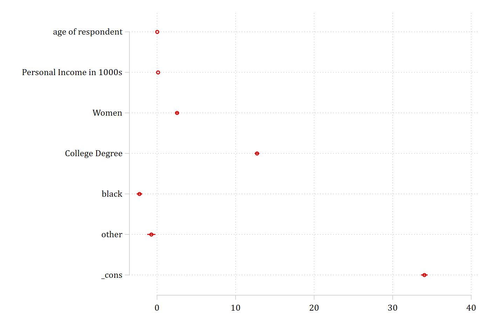
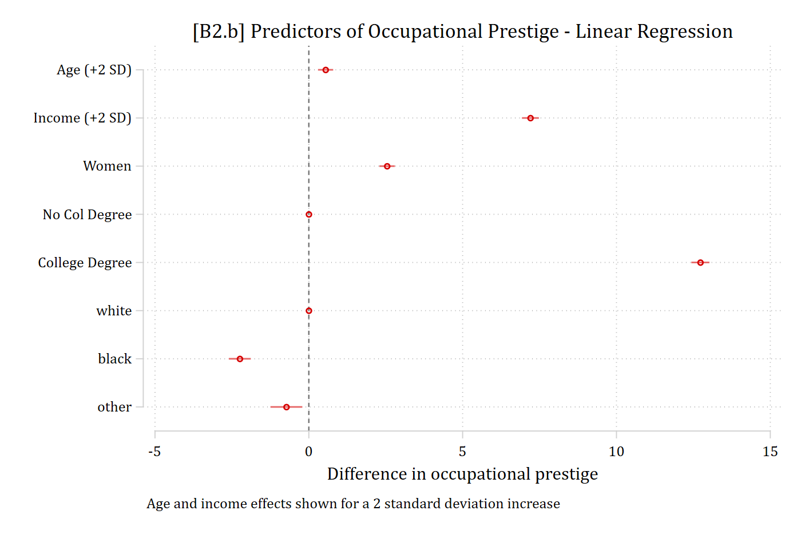

- Run the code below in R or Stata: it loads the data and makes a quick graph
- Discuss with your group:
  - What does the graph show?
  - What would you need to change to make it better, beyond the defaults?

::: {.panel-tabset group="language"}
## Stata

```{.stata-run}
. use "https://tdmize.github.io/data/data/gss.dta", clear
(gss.dta | GSS 1972 - 2016 Data | DMV Workshop)

. 
. regress occprest c.age c.income i.woman i.college i.race

      Source |       SS           df       MS      Number of obs   =    36,381
-------------+----------------------------------   F(6, 36374)     =   2648.96
       Model |  2184216.72         6   364036.12   Prob > F        =    0.0000
    Residual |  4998736.44    36,374  137.426086   R-squared       =    0.3041
-------------+----------------------------------   Adj R-squared   =    0.3040
       Total |  7182953.16    36,380  197.442363   Root MSE        =    11.723

-------------------------------------------------------------------------------
     occprest | Coefficient  Std. err.      t    P>|t|     [95% conf. interval]
--------------+----------------------------------------------------------------
          age |      0.020      0.005    4.337   0.000        0.011       0.029
       income |      0.129      0.003   51.304   0.000        0.124       0.134
              |
        woman |
       Women  |      2.544      0.129   19.721   0.000        2.291       2.797
              |
      college |
College De..  |     12.727      0.150   84.815   0.000       12.433      13.021
              |
         race |
       black  |     -2.243      0.182  -12.317   0.000       -2.600      -1.886
       other  |     -0.729      0.264   -2.757   0.006       -1.247      -0.211
              |
        _cons |     34.033      0.218  155.923   0.000       33.605      34.461
-------------------------------------------------------------------------------

. 
. coefplot

```

{width=80% fig-alt="Default coefficient plot of predictors of occupational prestige, including the constant: the constant (about 34) and the college degree effect (about 13) stretch the x-axis, so the other effects, including age and income, are squeezed together near zero."}

## R

```{r}
#| fig-alt: "Default coefficient plot of predictors of occupational prestige, including the intercept: the intercept and the college degree effect stretch the x-axis, so the other effects, including age and income, are squeezed together near zero."
library(foreign); library(modelsummary)

gss <- droplevels(read.dta("https://tdmize.github.io/data/data/gss.dta"))

reg_op <- lm(occprest ~ age + income + woman + college + race, data = gss)

modelplot(reg_op)
```

:::

## A publication-quality version

Show effects of the continuous IVs for a 2 standard deviation increase

::: {.panel-tabset group="language"}
## Stata

```{.stata-run}
. // B2.b - A publication-quality version
. * Show effects of the continuous IVs for a 2 standard deviation increase
. sum age if e(sample)

    Variable |        Obs        Mean    Std. dev.       Min        Max
-------------+---------------------------------------------------------
         age |     36,381    40.82744    13.45085         18         89

. global age2sd = 2*r(sd)

. sum income if e(sample)

    Variable |        Obs        Mean    Std. dev.       Min        Max
-------------+---------------------------------------------------------
      income |     36,381    31.36155    27.99743       .363        160

. global inc2sd = 2*r(sd)

. 
. coefplot, xline(0) baselevels ciop(col(*.6)) drop(_cons 0.woman) ///
>     rescale(age = $age2sd income = $inc2sd) ///
>     coeflabels(age = "Age (+2 SD)" income = "Income (+2 SD)") ///
>     xtitle("Difference in occupational prestige") ///
>     title("[B2.b] Predictors of Occupational Prestige - Linear Regression") //
> /
>     note("Age and income effects shown for a 2 standard deviation increase")

```

{width=80% fig-alt="[B2.b] Coefficient plot of predictors of occupational prestige without the constant, with age and income effects shown for a 2 standard deviation increase and a dashed line at zero: a college degree (about 12.7) and a 2 SD increase in income (about 7.2) have the largest effects, women are about 2.5 points higher, and Black respondents about 2.2 points lower."}

## R

```{r}
#| fig-alt: "[B2.b] Coefficient plot of predictors of occupational prestige without the intercept, with age and income effects shown for a 2 standard deviation increase and a dashed line at zero: a college degree and a 2 SD increase in income have the largest effects, women are about 2.5 points higher, and Black respondents about 2.2 points lower."
library(dplyr); library(ggplot2)
library(cleanplots)         # Mize's graphics scheme

## Use cleanplots colors, markers, lines, and theme for all graphs ##
cleanplots_defaults()
theme_update(plot.title.position = "plot")   # titles start at left edge of graph

# B2.b - A publication-quality version
# Show effects of the continuous IVs for a 2 standard deviation increase
gss_op <- filter(gss, !is.na(occprest), !is.na(age), !is.na(income), !is.na(woman),
                 !is.na(college), !is.na(race))
gss_op$age_2sd    <- gss_op$age / (2 * sd(gss_op$age))
gss_op$income_2sd <- gss_op$income / (2 * sd(gss_op$income))
reg_op2 <- lm(occprest ~ age_2sd + income_2sd + woman + college + race, data = gss_op)

modelplot(reg_op2, coef_omit = "Intercept",
          coef_rename = c("age_2sd" = "Age (+2 SD)", "income_2sd" = "Income (+2 SD)",
                          "womanWomen" = "Women",
                          "collegeCollege Degree" = "College degree",
                          "raceblack" = "Black", "raceother" = "Other race")) +
  geom_vline(xintercept = 0, linetype = "dashed", color = "gray20") +
  scale_y_discrete(limits = rev) +
  labs(x = "Difference in occupational prestige",
       title = "[B2.b] Predictors of Occupational Prestige - Linear Regression",
       caption = "Age and income effects shown for a 2 standard deviation increase")
```

:::
