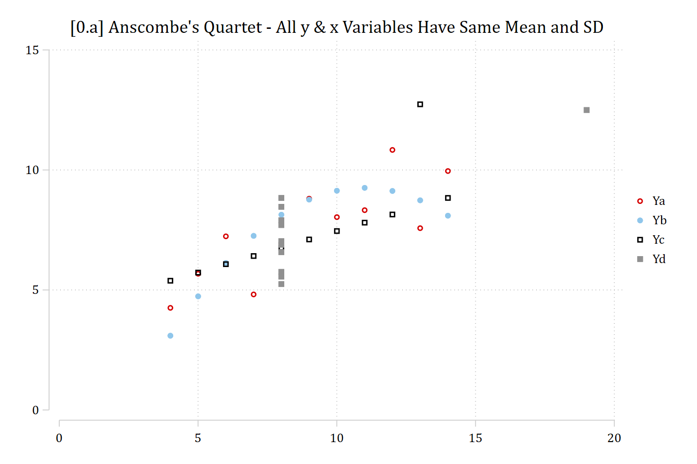
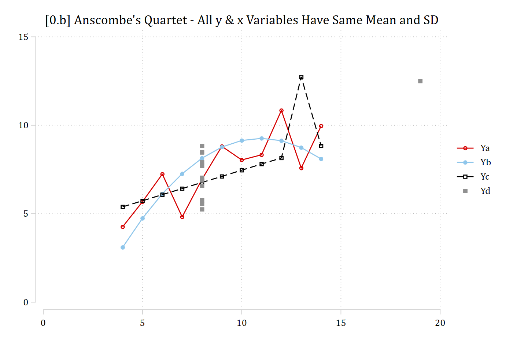
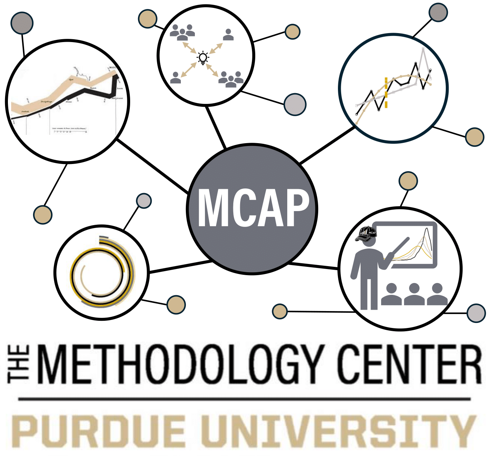
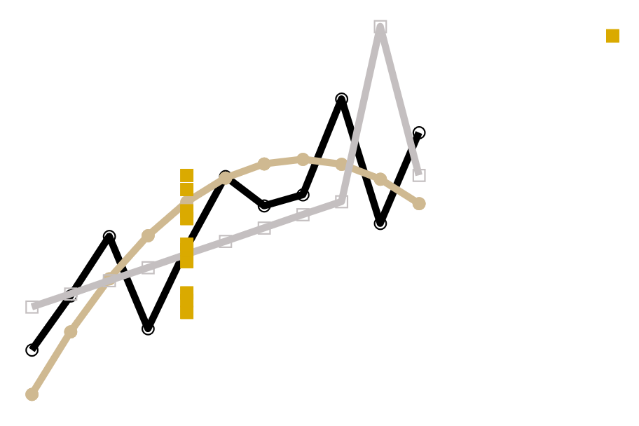
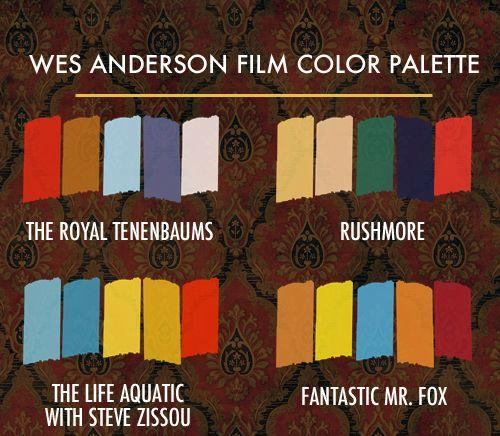
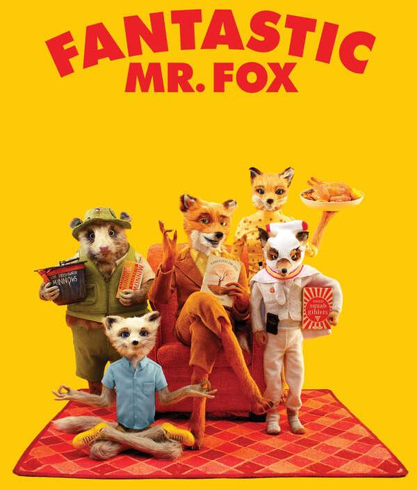

- Vital to understand data before analyzing it
  - Is coding correct? Is distribution skewed? Are there clear relationships between variables? Etc.
- These types of questions are easy to answer/process visually
  - The human brain can much more quickly understand visual information than numerical or textual information ([Medina 2008](https://brainrules.net/))

:::: {.columns}
::: {.column width="55%"}
*"The graphical method has considerable superiority for the exposition of statistical facts over the tabular. A heavy bank of figures is grievously wearisome to the eye, and the popular mind is as incapable of drawing any useful lessons from it as of extracting sunbeams from cucumbers." ([Farquhar and Farquhar 1891](https://books.google.com/books?hl=en&lr=&id=7bYIMv0XgfsC&oi=fnd&pg=PA1&dq=Farquhar+and+Farquhar+1891&ots=9N2es-pjK0&sig=8SWt5cnWvswmI_1OQSa3wwv7LCw#v=onepage&q=Farquhar%20and%20Farquhar%201891&f=false))*
:::
::: {.column width="45%"}
{width=45% fig-alt="Bright yellow sunbeams radiating from a center point."}
{width=45% fig-alt="Poster for the 1977 film Gulliver's Travels."}

{width=60% fig-alt="A sliced cucumber."}
:::
::::

## Assessing models via visualizations

[Anscombe's (1973)](https://www.tandfonline.com/doi/abs/10.1080/00031305.1973.10478966) quartet

::: {.panel-tabset group="language"}
## Stata

```{.stata-run}
. use "https://tdmize.github.io/data/data/anscombe.dta", clear

. 
. tabstat Y* Xabc Xd, stat(mean sd min max) format(%4.2f) col(stats)

    Variable |      Mean        SD       Min       Max
-------------+----------------------------------------
          Yb |      7.50      2.03      3.10      9.26
          Yc |      7.50      2.03      5.39     12.74
          Yd |      7.50      2.03      5.25     12.50
          Ya |      7.50      2.03      4.26     10.84
        Xabc |      9.00      3.32      4.00     14.00
          Xd |      9.00      3.32      8.00     19.00
------------------------------------------------------

. 
. qui regress Ya Xabc

. estimates store Ya

. qui regress Yb Xabc

. estimates store Yb

. qui regress Yc Xabc

. estimates store Yc

. qui regress Yd Xd

. estimates store Yd

. 
. esttab Ya Yb Yc Yd, b(2) se(2) title("Linear Regression Estimates")

Linear Regression Estimates
----------------------------------------------------------------------------
                      (1)             (2)             (3)             (4)   
                       Ya              Yb              Yc              Yd   
----------------------------------------------------------------------------
Xabc                 0.50**          0.50**          0.50**                 
                   (0.12)          (0.12)          (0.12)                   

Xd                                                                   0.50** 
                                                                   (0.12)   

_cons                3.00*           3.00*           3.00*           3.00*  
                   (1.12)          (1.13)          (1.12)          (1.12)   
----------------------------------------------------------------------------
N                      11              11              11              11   
----------------------------------------------------------------------------
Standard errors in parentheses
* p<0.05, ** p<0.01, *** p<0.001

```

## R

```{r}
library(foreign)            # load Stata datasets
library(ggplot2)            # main graphics package
library(modelsummary)       # coefficient plots & nice tables
library(cleanplots)         # Mize's graphics scheme

## Use cleanplots colors, markers, lines, and theme for all graphs ##
cleanplots_defaults()
theme_update(plot.title.position = "plot")   # titles start at left edge of graph

# Anscombe's quartet
anscombe <- read.dta("https://tdmize.github.io/data/data/anscombe.dta")

summary(anscombe[c("Ya", "Yb", "Yc", "Yd")])

amod1 <- lm(Ya ~ Xabc, data = anscombe)
amod2 <- lm(Yb ~ Xabc, data = anscombe)
amod3 <- lm(Yc ~ Xabc, data = anscombe)
amod4 <- lm(Yd ~ Xd, data = anscombe)
modelsummary(list(amod1, amod2, amod3, amod4), stars = TRUE)
```

:::

::: {.panel-tabset group="language"}
## Stata

```{.stata-run}
. sort Xabc // this forces lines to connect from left to right

. 
. // 0.a - Scatterplot of the data
. twoway ///
>     (scatter Ya Xabc) ///
>     (scatter Yb Xabc) ///
>     (scatter Yc Xabc) ///
>     (scatter Yd Xd), ///
>     ylab(0(5)15) xlab(0(5)20) ///
>     title("[0.a] Anscombe's Quartet - All y & x Variables Have Same Mean and S
> D")

```

{width=80% fig-alt="[0.a] Scatterplot of Anscombe's four y variables against x, each set in its own color and marker: the sets follow different patterns even though their summary statistics are the same."}

## R

```{r}
#| fig-alt: "[0.a] Scatterplot of Anscombe's four y variables against x, each set in its own color: the sets follow different patterns even though their summary statistics are the same."
# 0.a - Scatterplot of the data
ggplot(anscombe) +
  geom_point(aes(x = Xabc, y = Ya), color = cleanplots_colors("red"), size = 3) +
  geom_point(aes(x = Xabc, y = Yb), color = cleanplots_colors("ltblue"), size = 3) +
  geom_point(aes(x = Xabc, y = Yc), color = cleanplots_colors("gray"), size = 3) +
  geom_point(aes(x = Xd,   y = Yd), color = cleanplots_colors("black"), size = 3) +
  labs(x = "X", y = "Y",
       title = "[0.a] Anscombe's quartet - All y & x variables have same mean and SD")
```

:::

::: {.panel-tabset group="language"}
## Stata

```{.stata-run}
. // 0.b - Add connected lines
. twoway ///
>     (connected Ya Xabc) ///
>     (connected Yb Xabc) ///
>     (connected Yc Xabc) ///
>     (scatter Yd Xd), ///
>     ylab(0(5)15) xlab(0(5)20) ///
>     title("[0.b] Anscombe's Quartet - All y & x Variables Have Same Mean and S
> D")

```

{width=80% fig-alt="[0.b] The same scatterplot with lines connecting the points of the first three sets: one set rises roughly linearly with noise, one is a smooth upside-down U, and one is a straight line with a single outlier; the fourth set has all but one point at the same x value."}

## R

```{r}
#| fig-alt: "[0.b] The same scatterplot with lines connecting the points of the first three sets: one set rises roughly linearly with noise, one is a smooth upside-down U, and one is a straight line with a single outlier; the fourth set has all but one point at the same x value."
# 0.b - Add connected lines
ggplot(anscombe) +
  geom_point(aes(x = Xabc, y = Ya), color = cleanplots_colors("red"), size = 3) +
  geom_line( aes(x = Xabc, y = Ya), color = cleanplots_colors("red")) +
  geom_point(aes(x = Xabc, y = Yb), color = cleanplots_colors("ltblue"), size = 3) +
  geom_line( aes(x = Xabc, y = Yb), color = cleanplots_colors("ltblue")) +
  geom_point(aes(x = Xabc, y = Yc), color = cleanplots_colors("gray"), size = 3) +
  geom_line( aes(x = Xabc, y = Yc), color = cleanplots_colors("gray")) +
  geom_point(aes(x = Xd,   y = Yd), color = cleanplots_colors("black"), size = 3) +
  labs(x = "X", y = "Y",
       title = "[0.b] Anscombe's quartet - All y & x variables have same mean and SD")
```

:::

:::: {.columns}
::: {.column width="50%"}
{fig-alt="The Methodology Center illustration: small line drawings of graphs around a central MCAP circle."}
:::
::: {.column width="50%"}
{fig-alt="The Anscombe line plot that one of the Methodology Center illustration's small drawings is based on."}
:::
::::

\*[Read about The Methodology Center graphic](https://www.purdue.edu/research/mcap/illustration/)

## Good data visualization balances art and science

*"Data visualization is part art and part science. The challenge is to get the art right without getting the science wrong, and vice versa." ([Wilke 2019](https://clauswilke.com/dataviz/) p.1)*

:::: {.columns}
::: {.column width="60%"}
- Too many data visualization guides lean on aesthetic opinions only
  - Aesthetics are important...
- But there is a large scientific literature on what makes an **effective** data visualization
- Goal is to learn general principles to guide any data or model visualization
  - To make visualizations that are both effective and beautiful
- Along the way, add to your toolbox of visualization strategies
  - Learn what tools are effective for what types of data and situations
:::
::: {.column width="40%"}
{fig-alt="The Wes Anderson film color palette: rows of colored bars for The Royal Tenenbaums, Rushmore, The Life Aquatic, and Fantastic Mr. Fox."}

{width=70% fig-alt="Poster for Fantastic Mr. Fox."}
:::
::::
